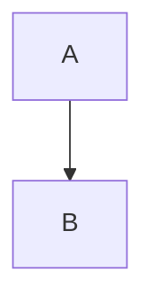

# URL shortener

URL shortener made with [uv](https://docs.astral.sh/uv/).

## Architecture

## Approach

This project is inspired by [AlgoMaster's "Design URL Shortener" article](https://algomaster.io/learn/system-design-interviews/design-url-shortener).

Steps:
- [] URL shortener logic (cleanup, hash generation, truncate and encode)
- [] URL redirection (resolve the shortened URL into the original, redirect)
- [] UI
- [] URL caching
- [] URL expiration (TTL)

## Status

Ongoing...

## Author

[Sarah Gäumann](mailto:sgaeumann@proton.me)